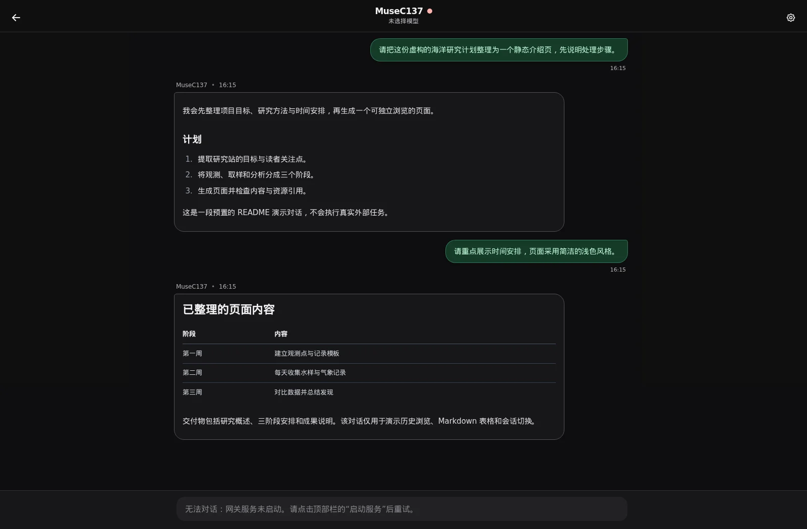
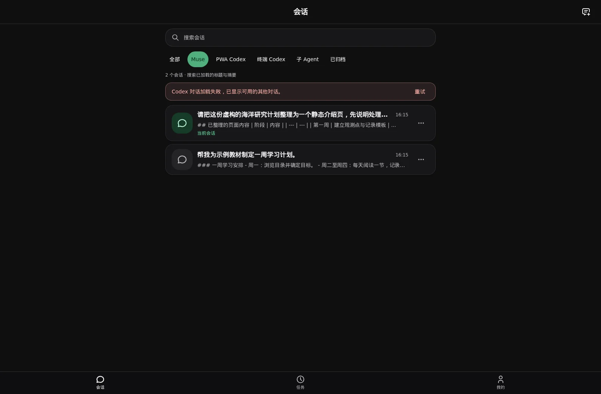
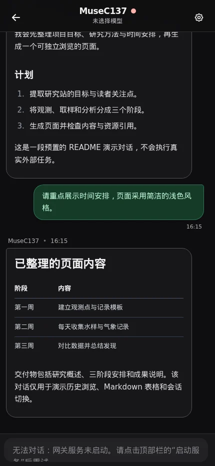
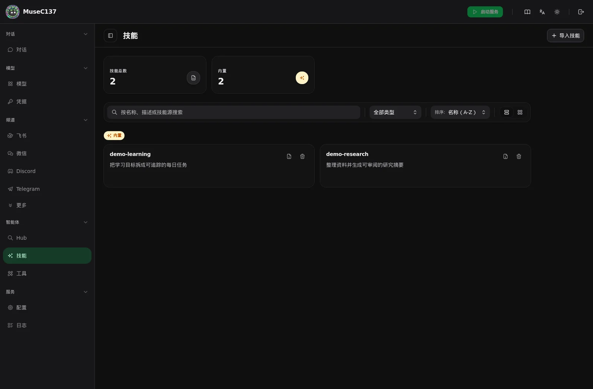
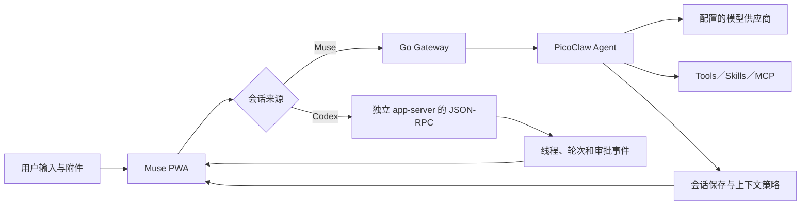
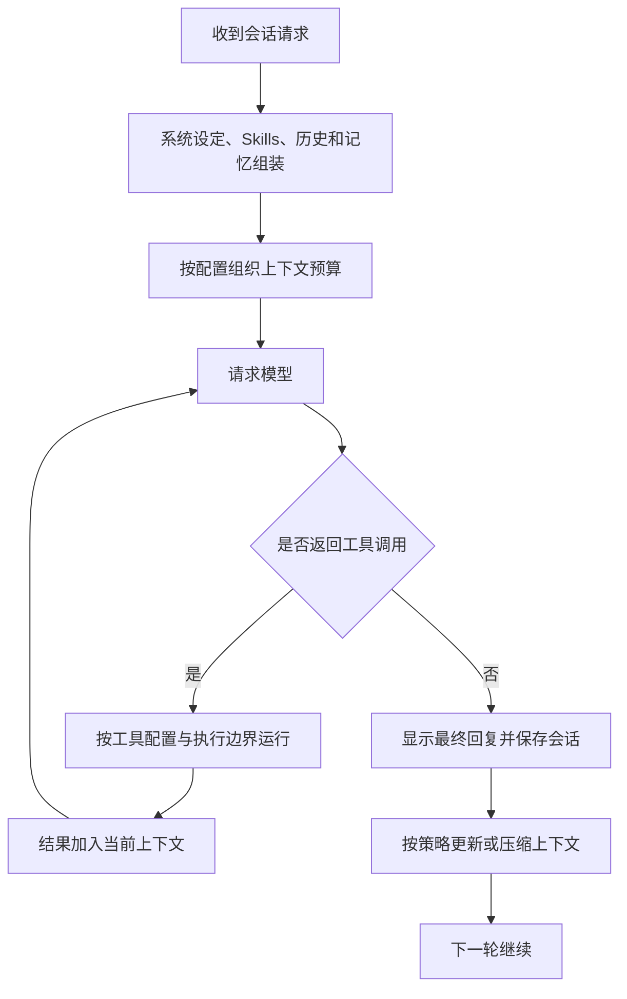

# MuseC137 · 自托管 Agent 工作台

**从一句请求，到工具执行，再到能回看和继续的工作记录。**

MuseC137 基于 [PicoClaw](https://github.com/sipeed/picoclaw) 开发，面向自托管使用场景，提供 PWA 会话、Skills 与工具管理，以及独立的 Codex 线程接入。

本仓库继承 PicoClaw 的 Go Agent、模型适配和基础工具；本分支围绕实际使用补充客户端交互、历史缓存、会话协调和集成能力。原始项目介绍完整保留在 [README.upstream.md](README.upstream.md)，授权信息见 [LICENSE](LICENSE)。

[应用预览](#应用预览) · [AI 如何执行](#ai-如何执行) · [从源码启动](#从源码启动) · [截图复现](docs/muse-demo.md) · [详细架构](docs/muse-architecture.md)



## 这个分支重点做了什么

| 方向 | 当前可见能力 | 源码入口 |
| --- | --- | --- |
| 会话体验 | 来源筛选、搜索、置顶与归档偏好、局部显示名、逐项批量删除结果 | `web/frontend/src/components/chat/session-list-page.tsx` |
| 多执行源 | Muse 会话与 Codex 线程独立适配；Codex 使用共享 JSON-RPC 连接 | `web/frontend/src/api/codex-socket-manager.ts` |
| 长历史 | 分页、虚拟列表、流式更新批处理、历史缓存和阅读位置恢复 | `web/frontend/src/features/chat/`、`features/codex/` |
| 继续工作 | 草稿与附件引用保存、网络恢复、按状态显示操作边界 | `web/frontend/src/features/chat/controller.ts` |
| 移动使用 | PWA 会话入口、触摸交互、图片预览和移动导航 | `web/frontend/src/components/` |
| 运维入口 | 模型、Skills、工具和日志查看；与网关状态分开呈现 | `web/frontend/src/routes/` |
| 上下文机制 | 支持策略化上下文管理与 Seahorse 检索实现，具体行为由配置决定 | `pkg/agent/context_manager.go`、`pkg/seahorse/` |

以上描述当前分支中可定位的能力，不意味着所有模块均为本分支原创，或已在所有设备和供应商上验证。

## 应用预览

以下截图来自**真实启动的临时 Launcher 与前端**。两段历史对话和两个 Skills 为独立编写的演示数据，未使用生产记录或在线模型。模型未配置时，输入区和网关会显示相应状态，不伪装成正在执行的 Agent。

### 按来源找到要继续的工作

会话入口提供 Muse、PWA Codex、终端 Codex 与子 Agent 等来源筛选。截图中 Codex 故意未连接，仍可查看已存在的 Muse 历史；这展示降级行为，不表示 Codex 已完成连接验收。



### 同一份会话在手机窗口中阅读



这是 PWA 页面截图，**不是原生 Android APK**。配套 Android 客户端独立维护，原生设备行为需要单独验证。

### 在工作台中查看和管理 Skills

演示实例只载入两个用于截图的 Skill，展示列表、搜索和分类界面；不包含个人安装目录。



## AI 如何执行

### 请求按执行源路由



Muse 和 Codex 是两条独立执行链，前端统一提供入口。Codex 接入不是把 PicoClaw 模型切换成 Codex，也不会让两个系统共享同一套历史格式。

### Muse 的模型—工具循环



工具种类、迭代次数、超时和工作区边界由配置与具体实现决定。Skills 提供任务说明和能力组织方式；执行动作仍经工具和模型协议完成。

Codex 的命令／文件审批、独立 RPC 连接、Seahorse 策略和源码入口见 [详细架构](docs/muse-architecture.md)。

## 从源码启动

需要 `go.mod` 指定的 Go 版本、Node.js 与前端 `package.json` 支持的版本，以及 pnpm 12.3.4。

```sh
pnpm --dir web/frontend install --frozen-lockfile
pnpm --dir web/frontend run build:backend
mkdir -p build
CGO_ENABLED=0 go build -o build/picoclaw-launcher ./web/backend

# 独立的本地配置目录，只绑定本机
mkdir -p .local-muse
PICOCLAW_HOME="$PWD/.local-muse" ./build/picoclaw-launcher \
  -console -no-browser -host 127.0.0.1 -port 18800 .local-muse/config.json
```

访问 `http://127.0.0.1:18800`，首次建立控制台密码，再配置自己的模型和渠道。未配置模型时，网关不会被演示脚本启动。不要把本机配置、工作区或运行数据提交进仓库。

本分支的 Codex 服务地址、工作目录与静态页根目录仍有宿主机约定；普通使用者需要按自己的部署调整，它们不是可直接复制的生产配置。完整基础安装方式也可参考 [上游说明](README.upstream.md)。

### 复现本页截图

```sh
pnpm --dir web/frontend exec playwright install chromium
pnpm --dir web/frontend run screenshots:readme
```

脚本会创建独立配置、虚构会话和演示 Skills，启动 `127.0.0.1:18809` 临时服务，截图后关闭。不会读取密码本，不连接生产 Codex，也不访问生产静态页目录。详细过程与二进制路径选项见 [muse-demo.md](docs/muse-demo.md)。

## 当前实现边界

- 缓存内容必须曾成功读取，离线功能不意味着所有历史与远程图片都可用。
- 部分置顶、归档和显示名是浏览器偏好，不能等同于全设备同步。
- 长任务通知与恢复依赖连接、权限和平台状态，不保证任意后台环境都持续在线。
- 记忆压缩和检索可帮助组织上下文，但不保证模型永不遗忘、调用正确或完成复杂任务。
- 单张截图不代表真实模型效果、完整 Codex 审批或原生 Android 后台可靠性。原始验收记录见 [PWA review](docs/reviews/pwa-20260928.md)。

技术栈：Go / PicoClaw Gateway、React、TypeScript、Vite、WebSocket、浏览器缓存与可配置的上下文存储。

## 凭据与发布检查

示例和截图使用虚构数据，真实模型密钥由使用者自行配置。发布前运行 `node scripts/check-secrets.mjs`；历史检查与凭据边界见 [SECURITY.md](SECURITY.md)。
