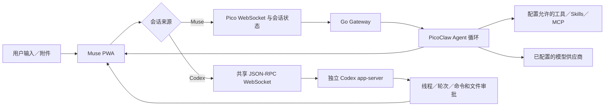
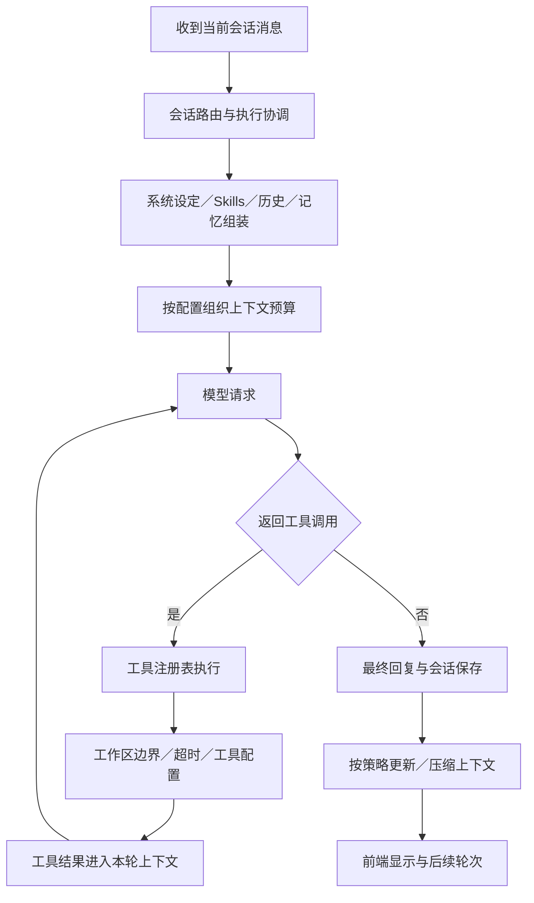
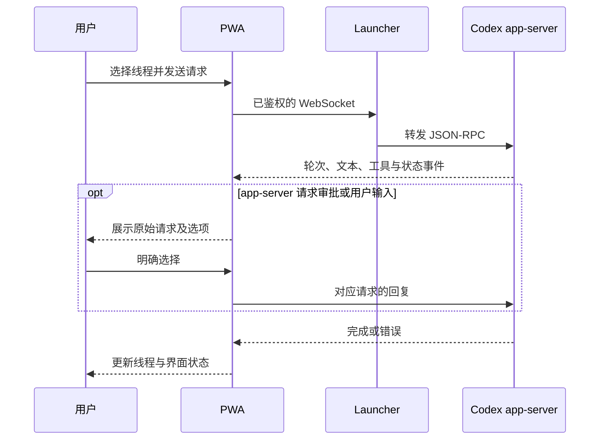

# Muse：客户端、Agent 与上下文的实际边界

## 两条执行链路

Muse/Pico 通道使用 Go 网关的 Agent；Codex 通道通过独立 app-server JSON-RPC 执行。前端统一提供会话入口，两个系统不共享同一套模型循环、历史格式或审批协议。

## Muse Agent 循环

循环、模型适配和工具基础来自 PicoClaw。执行次数与预算受配置约束；不是任意无限自治。不同工具、通道和配置的限制不同，不能仅凭界面开关推断系统级沙箱。

主要代码入口：

- `pkg/agent/agent.go`：Agent 及模型调用的基础协调。
- `pkg/agent/pipeline_execute.go`：工具执行路径。
- `pkg/agent/context.go`：系统上下文和提示贡献者。
- `pkg/agent/context_manager.go`：上下文策略接口，legacy 与 Seahorse 按配置选择。
- `pkg/agent/context_seahorse.go`、`pkg/seahorse/`：该策略启用时的组装、压缩与检索。
- `web/frontend/src/features/chat/controller.ts`：Muse 连接、会话状态和可见性协调。

## Codex 执行与审批

Launcher 的 Codex 地址和工作目录在当前分支仍有宿主机路径约定，见 `web/backend/api/codex.go`。这不是任意环境的一键配置完成品。演示截图明确断开该连接。

## 长历史与浏览器状态

- Muse 和 Codex 有独立缓存适配。会话列表分页读取，已加载内容可以在符合缓存范围时复用。
- 草稿、列表偏好、局部显示名和阅读位置按各自的浏览器存储键保存；它们不等于已同步到所有设备。
- Socket 管理与可见性协调减少重复连接；实际重连成功仍依赖网关、认证和网络。
- Seahorse 策略提供可检索上下文；是否启用、保留多少上下文及触发条件由配置和代码决定，不能从某张截图推断其生产效果。
- 观察事件可交给独立 observer/backend 处理；该配套部署不打包为本仓库的完整管理台。

## 继承、改造与演示

本项目保留 PicoClaw 的来源与 LICENSE。Muse 分支的展示重点是 PWA 会话体验、Codex 接入、浏览器缓存和可操作的管理界面；不是声称重新实现上游全部 Agent 基础设施。完整上游介绍保存在仓库根目录 `README.upstream.md`。

当前截图仅验证真实应用对虚构历史、Markdown、移动窗口与演示 Skills 的显示。复现步骤和隔离说明见 [muse-demo.md](muse-demo.md)。
